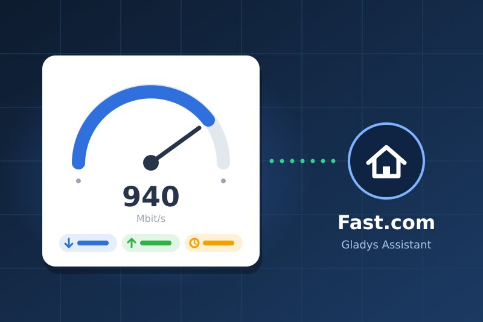
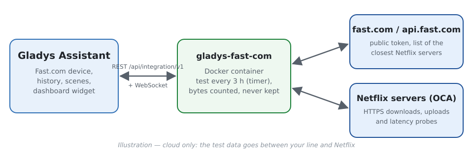
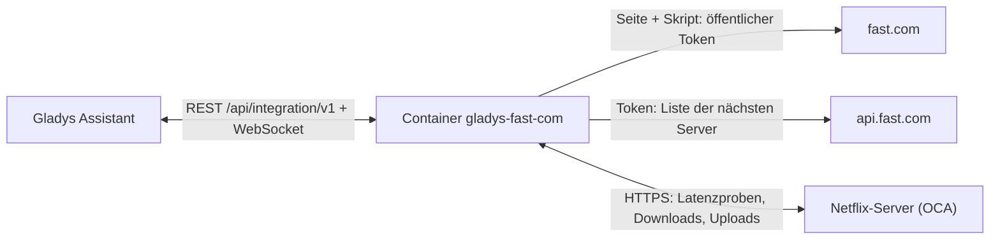
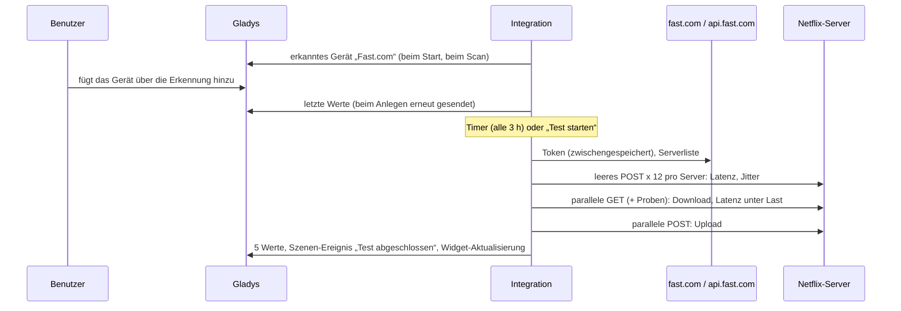
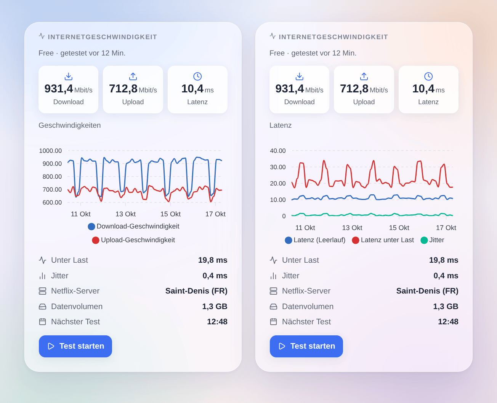

# Gladys Fast.com

[English](README.md) · [Français](README.fr.md) · **Deutsch** · [Español](README.es.md)

[](LICENSE)
[](https://github.com/William-De71/gladys-fast-com/releases)
[](https://github.com/William-De71/gladys-fast-com/actions/workflows/release.yml)
[](https://gladysassistant.com)



Externe Integration für [Gladys Assistant](https://gladysassistant.com), die deine Internetverbindung regelmäßig mit **Fast.com** misst, dem Geschwindigkeitstest von Netflix. Download, Upload, Latenz im Leerlauf und unter Last sowie Jitter werden Gerätewerte mit Verlauf; ein Dashboard-Widget zeigt sie mit einer Schaltfläche „Test starten“, und Szenen reagieren auf abgeschlossene oder fehlgeschlagene Tests und auf die Rückkehr der Verbindung.

Benutzerdokumentation: [English](docs/en.md) · [Français](docs/fr.md) · [Deutsch](docs/de.md) · [Español](docs/es.md).

> Community-Integration, weder mit Netflix verbunden noch von Netflix unterstützt. Fast.com bietet keine öffentliche API: Die Integration macht, was die Seite fast.com macht, und muss eventuell angepasst werden, wenn Netflix sie ändert.

## Funktionen

- Ein **Fast.com-Gerät** mit fünf schreibgeschützten Werten mit Verlauf: Download und Upload (Mbit/s), Latenz im Leerlauf, Jitter, Latenz unter Last (ms).
- **Automatische Tests** über einen internen Timer: standardmäßig alle 3 Stunden (30 Minuten bis einmal täglich, oder nur auf Abruf); jede Richtung endet, sobald die Geschwindigkeit stabil ist (standardmäßig höchstens 15 s).
- **3 Szenen-Auslöser**, **1 Szenen-Aktion** und **1 Dashboard-Widget** (siehe unten).
- **Kein Konto, kein Schlüssel, keine proprietäre Binärdatei**: reines Node.js, Messung im Datenstrom (nichts wird in den 256 MB des Containers gepuffert), immer nur ein Test.
- **Ausfallerkennung**: Solange Tests fehlschlagen, zeigt eine leichte Prüfung (wenige Kilobyte) alle 5 Minuten, wann die Verbindung zurück ist.
- Überall vier Sprachen: Englisch, Französisch, Deutsch, Spanisch.

### Fast.com oder Speedtest.net?

Der Store bietet auch [Speedtest.net](https://github.com/guim31/gladys-speedtest) an (Ookla-Server, ebenfalls in reinem JavaScript). Beide beantworten leicht unterschiedliche Fragen: Speedtest.net misst zu einem Server aus seinem Katalog (automatisch oder von dir gewählt), Fast.com zu den **Netflix-Servern**, die dein Anbieter zum Streamen von Videos nutzt und die oft in seinem eigenen Netz stehen. Diese Integration misst außerdem die **Latenz unter Last** (wie stark eine ausgelastete Leitung alles andere verzögert) und bietet Szenen-Auslöser und eine Szenen-Aktion. Beide lassen sich parallel installieren.

## Funktionsweise







Die Messung folgt dem offiziellen Web-Client (aus seinem Code gelesen): POST auf `…/speedtest/range/0-0` für die Latenz (ein HTTP-Roundtrip auf einer offenen Verbindung: in unseren Tests weniger als 1 ms Abweichung zu einem ICMP-Ping), 25-MB-Bereiche, die auf 2 bis 8 Verbindungen je nach Geschwindigkeit herunter- und hochgeladen werden; das Ergebnis ist die Rate der letzten Sekunden nach dem TCP-Anlauf.

### Transport

`transports: ["cloud"]`: Der Testverkehr läuft zwischen deiner Leitung und den Netflix-Servern im Internet; Netflix sieht deine öffentliche IP-Adresse, wie bei der Seite fast.com. Sonst verlässt nichts dein Netz, und die Integration speichert und protokolliert die IP-Adresse nicht. Das Gerät zeigt das Cloud-Badge und „nicht erreichbar“, solange das Internet ausgefallen ist.

## Geräte und Funktionen

| Funktion                 | Kategorie / Typ        | Einheit | Wert                                                  |
| ------------------------ | ---------------------- | ------- | ----------------------------------------------------- |
| Download-Geschwindigkeit | `datarate` / `rate`    | Mbit/s  | Rate der letzten Sekunden des Downloads               |
| Upload-Geschwindigkeit   | `datarate` / `rate`    | Mbit/s  | Ebenso für den Upload (wenn gemessen)                 |
| Latenz (Leerlauf)        | `duration` / `decimal` | ms      | Median von 12 Proben am besten Server                 |
| Jitter                   | `duration` / `decimal` | ms      | Mittlere Differenz aufeinanderfolgender Proben        |
| Latenz unter Last        | `duration` / `decimal` | ms      | Median der Proben während des Downloads (Bufferbloat) |

Ein Schwellenwert („Download unter 100 Mbit/s“) ist eine **Bedingung auf das Gerät** in einer Szene, kein Auslöser.

## Szenen-Auslöser, Aktionen und Widgets



- Auslöser: **Test abgeschlossen** (alle Werte als Variablen, Filter: vom Zeitplan oder von einer Person gestartet), **Test fehlgeschlagen** (Grund `offline`, `service` oder `measurement`, Fehler in Folge), **Verbindung wiederhergestellt** (Dauer des Ausfalls in Minuten).
- Aktion: **Geschwindigkeitstest starten** (mit oder ohne Upload, Zeitlimit 120 s), deren Werte (Download, Upload, Latenz, Jitter, Latenz unter Last, Anbieter, Server, Datenvolumen, Zusammenfassung) in die nächsten Aktionen fließen. Sie löst nie einen Fast.com-Auslöser aus.
- Widget: **Internetgeschwindigkeit** — letzte Werte, Verlauf der Geschwindigkeiten oder der Latenz (von einem Tag bis drei Monate, sobald das Gerät hinzugefügt ist), Latenz unter Last, Jitter, Server, Datenvolumen, nächster Test und **Test starten**.
- Beispiele: Wenn ein Test fehlschlägt, weil das Internet ausgefallen ist, die smarte Steckdose des Routers aus- und wieder einschalten; wenn die Verbindung wiederhergestellt ist, „Internet nach {{triggerEvent.data.outage_minutes}} Min. zurück“ senden; jeden Abend um 21 Uhr einen Test starten und benachrichtigen, wenn der Download unter 100 Mbit/s liegt.

Nicht umgesetzt: die Wahl des Servers (Fast.com wählt ihn), ein Auslöser „Geschwindigkeit unter Schwellenwert“ (eine Bedingung auf das Gerät erledigt das), die Wahl zwischen IPv4 und IPv6 (die Server sind die, die die API liefert).

## Voraussetzungen

- Gladys **5.3.0** oder neuer (ältere Versionen können die Integration nicht installieren: Widget, Szenen, Katalog-Suchbegriffe von Gladys 5.3).
- Eine Internetverbindung; für häufige Tests auf einer schnellen Leitung eine Verbindung ohne Datenlimit.

## Installation

- **Aus dem Store**: Integrationen → Fast.com → Installieren.
- **Über die Repository-URL**: Integrationen → Externe Integration hinzufügen → `https://github.com/William-De71/gladys-fast-com`.
- **Entwicklermodus**: `npm install`, dann neben einem Gladys im Entwicklermodus mit den Variablen unten starten.

## Konfiguration

| Feld                        | Standard       | Zweck                                                         |
| --------------------------- | -------------- | ------------------------------------------------------------- |
| Automatischer Test          | Alle 3 Stunden | 30 Min., 1, 2, 3, 6, 12 Std., einmal täglich oder deaktiviert |
| Maximale Dauer pro Richtung | 15 Sekunden    | 10, 15, 20 oder 30 s; jede Richtung endet, sobald stabil      |
| Auch den Upload messen      | An             | Aus: nur Download und Latenz (etwa die Hälfte der Daten)      |
| Sprache der Funktionsnamen  | Automatisch    | Namen der Funktionen beim Hinzufügen des Geräts               |

Konfigurationsaktionen: **Jetzt einen Test starten** (wartet auf das Ergebnis) und **Diagnose** (eine Zusammenfassung in den Protokollen, ohne IP-Adresse).

**Datenvolumen**: Bei 1 Gbit/s hat ein Test in unseren Messungen 1,2 bis 1,4 GB übertragen (beide Richtungen); auf einer langsameren Leitung entsprechend weniger. Alle 3 Stunden sind das auf einer 1-Gbit/s-Leitung etwa 10 GB pro Tag: Wähle bei einem begrenzten Tarif oder 4G ein längeres Intervall oder deaktiviere den Upload.

## Verwendung

Installieren, dann das Gerät **Fast.com** über die Erkennung hinzufügen (es speichert den Verlauf) und das Widget **Internetgeschwindigkeit** zu einem Dashboard hinzufügen. Der erste Test startet etwa eine Minute nach dem Start, dann im gewählten Intervall; ein Neustart startet keinen zusätzlichen Test.

Gut zu wissen:

- **Die Leitung wird geteilt**: Ein Download, ein Video oder eine Sicherung auf einem anderen Gerät während eines Tests senkt das Ergebnis. Fast.com misst, was übrig bleibt, nicht die gebuchte Geschwindigkeit.
- **Der Container hat 0,5 CPU**: Die Integration überwacht ihre eigene Ereignisschleife. Wenn der Prozessor statt der Leitung das Tempo bestimmt, wird der Test als **durch den Prozessor begrenzt** markiert (Widget, Variable `cpu_limited`), und die Latenz unter Last wird nicht veröffentlicht statt falsch zu sein. Auf einem aktuellen x86-Rechner haben unsere Tests bei 1 Gbit/s etwa 0,2 CPU genutzt, ohne Begrenzung; auf einem kleinen Board ohne AES-Befehle (Raspberry Pi 4) können Geschwindigkeiten über einigen hundert Mbit/s zu niedrig gemessen werden (nicht gemessen).
- **Im Vergleich zur Seite fast.com** weichen die Werte um einige Prozent ab (Download 913 bis 933 Mbit/s gegenüber 960, die die Seite in einem Browser auf derselben Leitung in unseren Tests zeigte): Abbruchregel und Mittelung sind nicht identisch.

## Entwicklung

```bash
npm install
npm test                     # node --test, nie mit Netzwerkzugriff
npm run lint && npm run format:check
npm run measure              # ein ECHTER Test von diesem Rechner (Hunderte MB)
docker run --rm --cpus 0.5 --memory 256m -v "$PWD":/app:ro -w /app node:24-alpine node scripts/measure.mjs
npx github:GladysAssistant/integration-store . --skip-image-check
docs/illustrations/render.sh # Widget-Illustrationen
scripts/build-cover.sh       # cover.jpg
```

Umgebungsvariablen (vom Gladys-Supervisor gesetzt): `GLADYS_HOST_API_URL`, `GLADYS_INTEGRATION_TOKEN`, `GLADYS_INTEGRATION_SELECTOR`, `TZ` (angezeigte Uhrzeiten). `DATA_DIR` (Standard `/data`) enthält `state.json`: das letzte Ergebnis und den laufenden Ausfall, ohne IP-Adresse.

## Release-Prozess


Jeder Merge auf `main` startet die CI und berechnet dann die Version aus den [Conventional Commits](https://www.conventionalcommits.org/de/) seit dem letzten Tag: `feat` → Minor, `fix` / `perf` → Patch, `!` oder `BREAKING CHANGE` → Major (unter 1.0.0 ein Minor); `docs`, `chore`, `ci`, `test`, `style`, `refactor`, `build` allein veröffentlichen nichts. Ohne Tag wird 0.1.0 unverändert veröffentlicht. Der Changelog-Abschnitt wird erzeugt, der Tag gepusht, das Multi-Architektur-Image gebaut, dann erhält `main` den Release-Commit (der Store sieht also nie eine Version ohne Image), das GitHub Release wird erstellt, und ein letzter Job prüft das öffentliche Image, den Store-Validator und das Topic.

- Der Titel des Pull Requests wird zum Squash-Commit und dann zur Changelog-Zeile: Schreibe ihn auf Englisch, für den Benutzer (`pr-title.yml` prüft ihn). `CHANGELOG.md` nie von Hand bearbeiten.
- 1.0.0 ist eine Entscheidung: Actions → Release → Run workflow mit `release-as: 1.0.0`. `dry-run` zeigt Version und Notizen, ohne etwas zu veröffentlichen.
- **Geschützter Branch**: Das Release pusht seinen Commit mit `GITHUB_TOKEN` auf `main`. Bei einem Ruleset auf `main` GitHub Actions zur Bypass-Liste hinzufügen (oder über eine GitHub App pushen), sonst schlägt der Veröffentlichungsjob fehl.
- Nach dem ersten Release muss das `ghcr.io`-Paket öffentlich sein (Package settings → Change visibility).

## Fehlerbehebung

Siehe [docs/de.md](docs/de.md#fehlerbehebung) (niedrigere Geschwindigkeit als erwartet, Prozessorgrenze, „Fast.com hat den Test abgelehnt“, kein Verlauf). Bitte Probleme mit den Versionen von Gladys und der Integration, deiner Leitung, dem Wert von fast.com in einem Browser im selben Netz und der Ausgabe der Schaltfläche **Diagnose** (Einstellungen → Supervision) melden.

## Mitwirken

Issues und Pull Requests sind willkommen. Führe vor einem Pull Request `npm run format:check && npm run lint && npm test` aus und ändere keine externe ID und keinen gespeicherten Schlüssel (siehe [CLAUDE.md](CLAUDE.md)).

## Sicherheit

Siehe [SECURITY.md](SECURITY.md): Sicherheitslücken bitte privat melden. Die Integration hat kein Geheimnis zu schützen; sie spricht nur mit fast.com, api.fast.com und den von der API gelisteten Netflix-Servern (HTTPS) und speichert oder protokolliert nie deine IP-Adresse.

## Kommende Screenshots

Die Bilder oben sind Illustrationen, keine Screenshots. Echte Screenshots kommen nach `docs/assets/screenshots/` (PNG, 1280 × 800): `configuration.png`, `discovery.png`, `device.png`, `dashboard.png`.

## Lizenz

[Apache License 2.0](LICENSE) — siehe auch [NOTICE](NOTICE). Fast.com und Netflix sind Marken von Netflix, Inc.; diese Community-Integration ist nicht mit ihnen verbunden. Danke an die Dokumentation und das SDK von Gladys.
