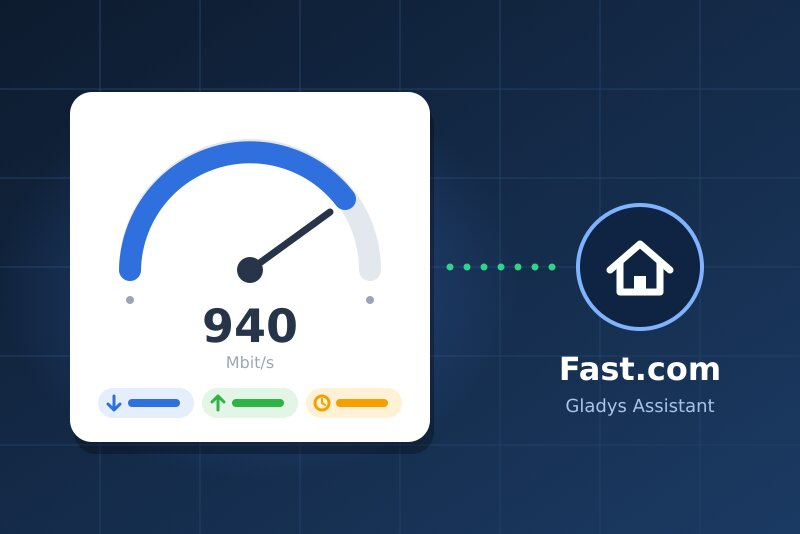
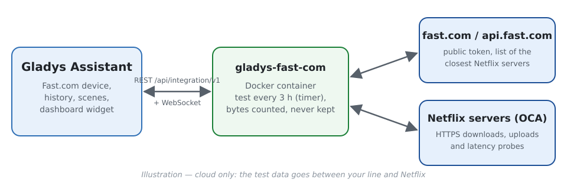
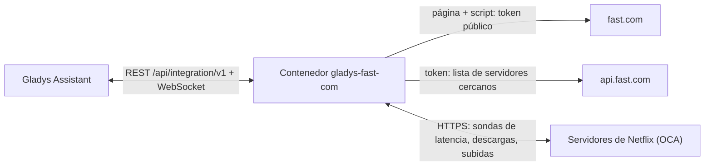
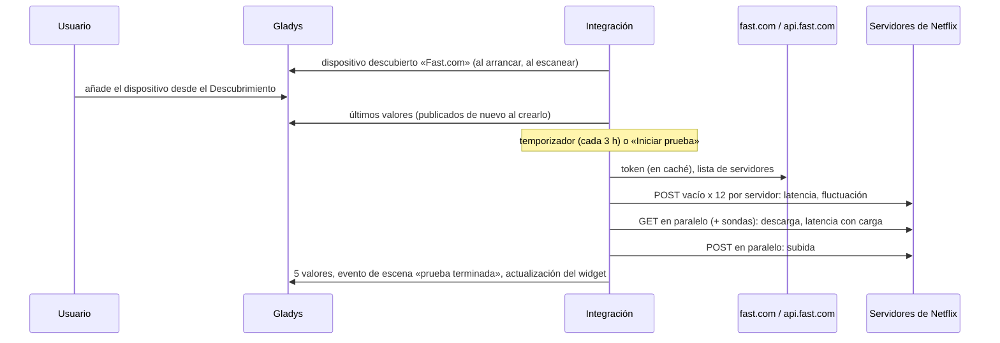
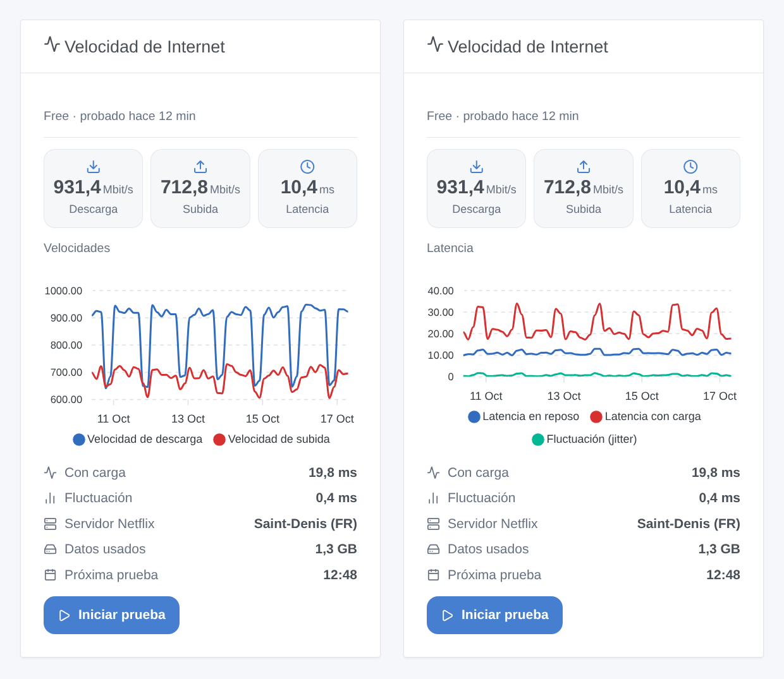

# Gladys Fast.com

[English](README.md) · [Français](README.fr.md) · [Deutsch](README.de.md) · **Español**

[](LICENSE)
[](https://github.com/William-De71/gladys-fast-com/releases)
[](https://github.com/William-De71/gladys-fast-com/actions/workflows/release.yml)
[](https://gladysassistant.com)



Integración externa para [Gladys Assistant](https://gladysassistant.com) que mide periódicamente tu conexión a Internet con **Fast.com**, la prueba de velocidad de Netflix. Descarga, subida, latencia en reposo y con carga, y fluctuación se convierten en valores de dispositivo con historial; un widget del panel los muestra con un botón «Iniciar prueba», y las escenas reaccionan a las pruebas terminadas o fallidas y a la vuelta de la conexión.

Documentación de usuario: [English](docs/en.md) · [Français](docs/fr.md) · [Deutsch](docs/de.md) · [Español](docs/es.md).

> Integración comunitaria, sin relación ni aprobación de Netflix. Fast.com no ofrece una API pública: la integración hace lo que hace la página fast.com, y puede necesitar una actualización si Netflix la cambia.

## Funciones

- Un **dispositivo Fast.com** con cinco valores de solo lectura guardados en el historial: descarga y subida (Mbit/s), latencia en reposo, fluctuación, latencia con carga (ms).
- **Pruebas automáticas** con un temporizador interno: cada 3 horas por defecto (de 30 minutos a una vez al día, o solo a demanda), y cada sentido se detiene en cuanto la velocidad es estable (15 s como máximo por defecto).
- **3 disparadores de escena**, **1 acción de escena** y **1 widget del panel** (ver abajo).
- **Sin cuenta, sin clave, sin binario propietario**: Node.js puro, medición en flujo (nada se guarda en los 256 MB del contenedor), una sola prueba a la vez.
- **Detección de caídas**: mientras las pruebas fallan, una comprobación ligera (unos pocos kilobytes) cada 5 minutos indica cuándo vuelve la conexión.
- Cuatro idiomas en todas partes: inglés, francés, alemán, español.

### ¿Fast.com o Speedtest.net?

La tienda también ofrece [Speedtest.net](https://github.com/guim31/gladys-speedtest) (servidores de Ookla, también en JavaScript puro). Ambas responden a preguntas algo distintas: Speedtest.net mide hacia un servidor de su catálogo (elegido automáticamente o por ti), Fast.com hacia los **servidores de Netflix** que tu proveedor usa para emitir vídeo, a menudo alojados en su propia red. Esta integración también mide la **latencia con carga** (cuánto retrasa todo lo demás una línea ocupada) y ofrece disparadores y una acción de escena. Ambas pueden instalarse a la vez.

## Funcionamiento







La medición sigue al cliente web oficial (leído en su código): POST en `…/speedtest/range/0-0` para la latencia (un viaje de ida y vuelta HTTP en una conexión ya abierta: a menos de 1 ms de un ping ICMP en nuestras pruebas), rangos de 25 MB descargados y subidos en 2 a 8 conexiones según la velocidad; el resultado es la velocidad de los últimos segundos, una vez pasado el arranque de TCP.

### Transporte

`transports: ["cloud"]`: el tráfico de la prueba va entre tu línea y los servidores de Netflix en Internet; Netflix ve tu dirección IP pública, como con la página fast.com. Nada más sale de tu red, y la integración no guarda ni registra la dirección IP. El dispositivo muestra la insignia cloud, e «inaccesible» mientras Internet está caído.

## Dispositivos y funciones

| Función               | Categoría / tipo       | Unidad | Valor                                                   |
| --------------------- | ---------------------- | ------ | ------------------------------------------------------- |
| Velocidad de descarga | `datarate` / `rate`    | Mbit/s | Velocidad de los últimos segundos de la descarga        |
| Velocidad de subida   | `datarate` / `rate`    | Mbit/s | Igual para la subida (cuando se mide)                   |
| Latencia en reposo    | `duration` / `decimal` | ms     | Mediana de 12 sondas en el mejor servidor               |
| Fluctuación (jitter)  | `duration` / `decimal` | ms     | Diferencia media entre sondas consecutivas              |
| Latencia con carga    | `duration` / `decimal` | ms     | Mediana de las sondas durante la descarga (bufferbloat) |

Un umbral («descarga por debajo de 100 Mbit/s») es una **condición sobre el dispositivo** en una escena, no un disparador.

## Disparadores, acciones de escena y widgets



- Disparadores: **prueba terminada** (todos los valores como variables, filtro: iniciada por la programación o por una persona), **prueba fallida** (motivo `offline`, `service` o `measurement`, fallos seguidos), **conexión restablecida** (duración de la caída en minutos).
- Acción: **iniciar una prueba de velocidad** (con o sin subida, plazo de 120 s) cuyos valores (descarga, subida, latencia, fluctuación, latencia con carga, proveedor, servidor, datos usados, resumen) alimentan las acciones siguientes. Nunca activa un disparador de Fast.com.
- Widget: **Velocidad de Internet** — últimos valores, historial de velocidades o de latencia (de un día a tres meses, una vez añadido el dispositivo), latencia con carga, fluctuación, servidor, datos usados, próxima prueba e **Iniciar prueba**.
- Ejemplos: cuando una prueba falla porque Internet está caído, apagar y volver a encender el enchufe inteligente del router; cuando se restablece la conexión, enviar «Internet de vuelta tras {{triggerEvent.data.outage_minutes}} min»; cada noche a las 21 h, iniciar una prueba y avisar si la descarga baja de 100 Mbit/s.

No implementado: la elección del servidor (Fast.com lo elige), un disparador «velocidad por debajo de un umbral» (una condición sobre el dispositivo lo hace), la elección entre IPv4 e IPv6 (los servidores son los que da la API).

## Requisitos

- Gladys **5.1.0** o posterior (las versiones anteriores no pueden instalar la integración: widget y escenas).
- Una conexión a Internet; una conexión sin límite de datos para pruebas frecuentes en una línea rápida.

## Instalación

- **Desde la tienda**: Integraciones → Fast.com → Instalar.
- **Desde la URL del repositorio**: Integraciones → Añadir una integración externa → `https://github.com/William-De71/gladys-fast-com`.
- **Modo desarrollador**: `npm install`, y luego ejecútala junto a un Gladys en modo desarrollador con las variables de abajo.

## Configuración

| Campo                              | Por defecto  | Uso                                                       |
| ---------------------------------- | ------------ | --------------------------------------------------------- |
| Prueba automática                  | Cada 3 horas | 30 min, 1, 2, 3, 6, 12 h, una vez al día o desactivada    |
| Duración máxima por sentido        | 15 segundos  | 10, 15, 20 o 30 s; cada sentido se detiene al ser estable |
| Medir también la subida            | Activado     | Desactivado: solo descarga y latencia (la mitad de datos) |
| Idioma de los nombres de funciones | Automático   | Nombres de las funciones al añadir el dispositivo         |

Acciones de configuración: **Iniciar una prueba ahora** (espera el resultado) y **Diagnóstico** (un resumen en los registros, sin dirección IP).

**Datos consumidos**: a 1 Gbit/s, una prueba movió de 1,2 a 1,4 GB en nuestras mediciones (ambos sentidos); en una línea más lenta, proporcionalmente menos. Cada 3 horas, son unos 10 GB al día en una línea de 1 Gbit/s: elige un intervalo más largo, o desactiva la subida, con una conexión limitada o 4G.

## Uso

Instala y añade el dispositivo **Fast.com** desde el Descubrimiento (guarda el historial) y el widget **Velocidad de Internet** a un panel. La primera prueba empieza aproximadamente un minuto después del arranque, y luego al intervalo elegido; un reinicio no lanza una prueba adicional.

Conviene saber:

- **La línea es compartida**: una descarga, un vídeo o una copia de seguridad en otro dispositivo durante una prueba baja el resultado. Fast.com mide lo que queda disponible, no la velocidad contratada.
- **El contenedor dispone de 0,5 CPU**: la integración vigila su propio bucle de eventos. Si el procesador marca el ritmo en lugar de la línea, la prueba se marca como **limitada por el procesador** (widget, variable `cpu_limited`) y la latencia con carga no se publica en lugar de ser errónea. En una máquina x86 reciente, nuestras pruebas a 1 Gbit/s usaron unos 0,2 CPU sin limitación; en una placa pequeña sin instrucciones AES (Raspberry Pi 4), las velocidades por encima de unos cientos de Mbit/s pueden quedar subestimadas (no medido).
- **Respecto a la página fast.com**, los valores difieren unos pocos por ciento (descarga de 913 a 933 Mbit/s frente a 960 mostrados por la página en un navegador en la misma línea durante nuestras pruebas): la regla de parada y el promedio no son idénticos.

## Desarrollo

```bash
npm install
npm test                     # node --test, nunca toca la red
npm run lint && npm run format:check
npm run measure              # una prueba REAL desde esta máquina (cientos de MB)
docker run --rm --cpus 0.5 --memory 256m -v "$PWD":/app:ro -w /app node:24-alpine node scripts/measure.mjs
npx github:GladysAssistant/integration-store . --skip-image-check
docs/illustrations/render.sh # ilustraciones de los widgets
scripts/build-cover.sh       # cover.jpg
```

Variables de entorno (las define el supervisor de Gladys): `GLADYS_HOST_API_URL`, `GLADYS_INTEGRATION_TOKEN`, `GLADYS_INTEGRATION_SELECTOR`, `TZ` (horas mostradas). `DATA_DIR` (por defecto `/data`) contiene `state.json`: el último resultado y la caída en curso, sin dirección IP.

## Proceso de publicación


Cada fusión en `main` ejecuta la CI y calcula la versión a partir de los [Conventional Commits](https://www.conventionalcommits.org/es/) desde la última etiqueta: `feat` → menor, `fix` / `perf` → parche, `!` o `BREAKING CHANGE` → mayor (una menor por debajo de 1.0.0); `docs`, `chore`, `ci`, `test`, `style`, `refactor`, `build` solos no publican nada. Sin etiqueta, la 0.1.0 se publica tal cual. Se genera la sección del changelog, se sube la etiqueta, se construye la imagen multiarquitectura y luego `main` recibe el commit de publicación (la tienda nunca ve una versión sin su imagen), se crea la GitHub Release y un último job comprueba la imagen pública, el validador de la tienda y el topic.

- El título de la pull request se convierte en el commit squash y luego en la línea del changelog: escríbelo en inglés, para el usuario (`pr-title.yml` lo comprueba). Nunca edites `CHANGELOG.md` a mano.
- La 1.0.0 es una decisión: Actions → Release → Run workflow con `release-as: 1.0.0`. `dry-run` muestra la versión y las notas sin publicar nada.
- **Rama protegida**: la publicación sube su commit a `main` con `GITHUB_TOKEN`. Con un ruleset en `main`, añade GitHub Actions a su lista de omisión (o sube mediante una GitHub App); si no, el job de publicación falla.
- Tras la primera publicación, el paquete `ghcr.io` debe ser público (Package settings → Change visibility).

## Solución de problemas

Ver [docs/es.md](docs/es.md#solución-de-problemas) (velocidad más baja de lo esperado, límite del procesador, «Fast.com rechazó la prueba», sin historial). Informa de los problemas con las versiones de Gladys y de la integración, tu línea, lo que muestra fast.com en un navegador en la misma red y la salida del botón **Diagnóstico** (Ajustes → Supervisión).

## Contribuir

Issues y pull requests son bienvenidas. Ejecuta `npm run format:check && npm run lint && npm test` antes de abrir una pull request, y no cambies ningún identificador externo ni ninguna clave guardada (ver [CLAUDE.md](CLAUDE.md)).

## Seguridad

Ver [SECURITY.md](SECURITY.md): informa de las vulnerabilidades en privado. La integración no tiene ningún secreto que guardar; solo habla con fast.com, api.fast.com y los servidores de Netflix que lista la API (HTTPS), y nunca guarda ni registra tu dirección IP.

## Capturas pendientes

Las imágenes de arriba son ilustraciones, no capturas de pantalla. Las capturas reales irán en `docs/assets/screenshots/` (PNG, 1280 × 800): `configuration.png`, `discovery.png`, `device.png`, `dashboard.png`.

## Licencia

[Licencia Apache 2.0](LICENSE) — ver también [NOTICE](NOTICE). Fast.com y Netflix son marcas de Netflix, Inc.; esta integración comunitaria no está vinculada a ellas. Gracias a la documentación y al SDK de Gladys.
