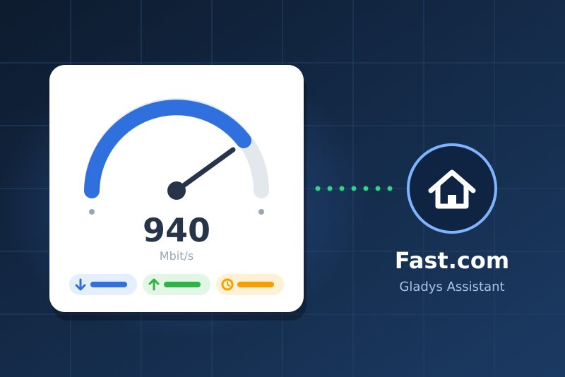
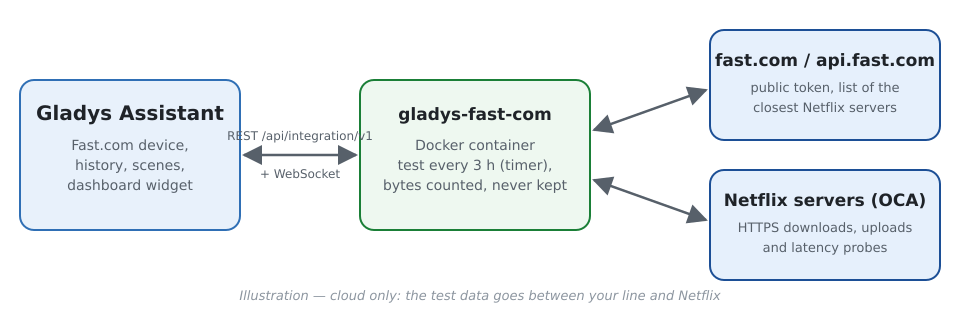
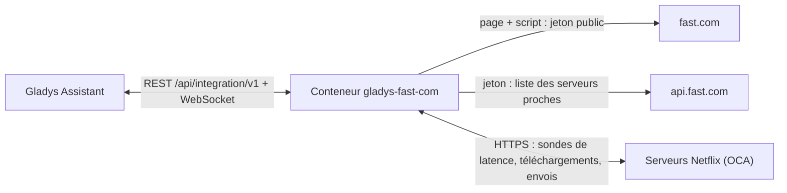
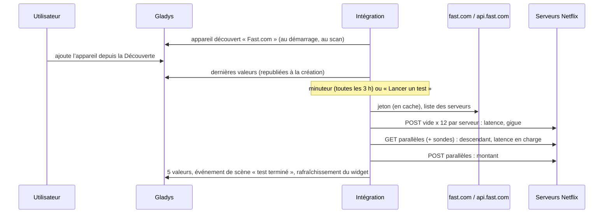
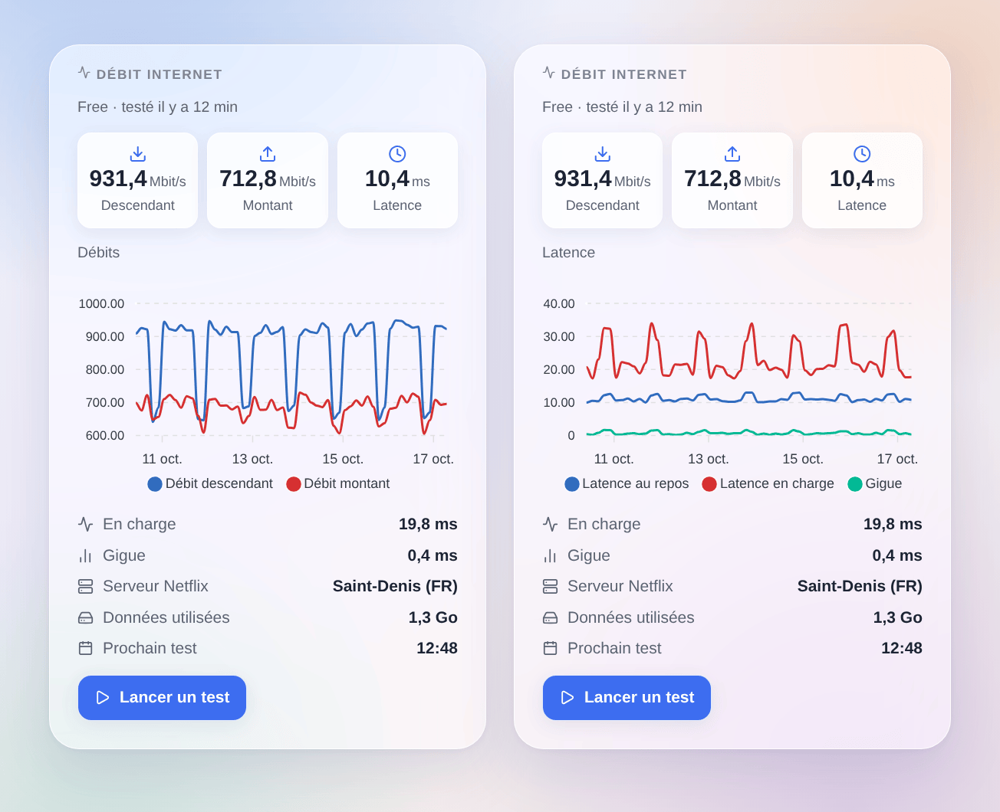

# Gladys Fast.com

[English](README.md) · **Français** · [Deutsch](README.de.md) · [Español](README.es.md)

[](LICENSE)
[](https://github.com/William-De71/gladys-fast-com/releases)
[](https://github.com/William-De71/gladys-fast-com/actions/workflows/release.yml)
[](https://gladysassistant.com)



Intégration externe pour [Gladys Assistant](https://gladysassistant.com) qui mesure régulièrement votre connexion Internet avec **Fast.com**, le test de débit de Netflix. Débit descendant, débit montant, latence au repos et en charge, et gigue deviennent des valeurs d’appareil avec historique ; un widget de tableau de bord les affiche avec un bouton « Lancer un test », et des scènes réagissent aux tests terminés ou échoués et au retour de la connexion.

Documentation utilisateur : [English](docs/en.md) · [Français](docs/fr.md) · [Deutsch](docs/de.md) · [Español](docs/es.md).

> Intégration communautaire, ni affiliée ni approuvée par Netflix. Fast.com n’a pas d’API publique : l’intégration fait ce que fait la page fast.com, et peut nécessiter une mise à jour si Netflix la modifie.

## Fonctionnalités

- Un **appareil Fast.com** avec cinq valeurs en lecture seule gardées en historique : débits descendant et montant (Mbit/s), latence au repos, gigue, latence en charge (ms).
- **Tests automatiques** par un minuteur interne : toutes les 3 heures par défaut (de 30 minutes à une fois par jour, ou uniquement à la demande), chaque sens s’arrêtant dès que le débit est stable (15 s au plus par défaut).
- **3 déclencheurs de scène**, **1 action de scène** et **1 widget de tableau de bord** (voir plus bas).
- **Ni compte, ni clé, ni binaire propriétaire** : Node.js pur, mesure en flux (rien n’est gardé en mémoire dans les 256 Mo du conteneur), un seul test à la fois.
- **Détection des coupures** : tant que les tests échouent, une vérification légère (quelques kilo-octets) toutes les 5 minutes indique le retour de la connexion.
- Quatre langues partout : anglais, français, allemand, espagnol.

### Fast.com ou Speedtest.net ?

Le store propose aussi [Speedtest.net](https://github.com/guim31/gladys-speedtest) (serveurs Ookla, lui aussi en JavaScript pur). Les deux répondent à des questions un peu différentes : Speedtest.net mesure vers un serveur de son catalogue (choisi automatiquement ou par vous), Fast.com vers les **serveurs Netflix** que votre fournisseur utilise pour diffuser la vidéo, souvent hébergés dans son propre réseau. Cette intégration mesure aussi la **latence en charge** (à quel point une ligne occupée retarde tout le reste) et propose des déclencheurs et une action de scène. Les deux peuvent être installées côte à côte.

## Fonctionnement







La mesure suit le client web officiel (lu dans son code) : des POST sur `…/speedtest/range/0-0` pour la latence (un aller-retour HTTP sur une connexion déjà ouverte : à moins de 1 ms d’un ping ICMP dans nos essais), des plages de 25 Mo téléchargées puis envoyées sur 2 à 8 connexions selon le débit, le résultat étant le débit des dernières secondes, une fois la montée en charge TCP passée.

### Transport

`transports: ["cloud"]` : le trafic du test passe entre votre ligne et les serveurs Netflix sur Internet ; Netflix voit votre adresse IP publique, comme avec la page fast.com. Rien d’autre ne quitte votre réseau, et l’intégration ne stocke ni ne journalise l’adresse IP. L’appareil porte le badge cloud, et « injoignable » tant qu’Internet est coupé.

## Appareils et fonctionnalités

| Fonctionnalité    | Catégorie / type       | Unité  | Valeur                                                     |
| ----------------- | ---------------------- | ------ | ---------------------------------------------------------- |
| Débit descendant  | `datarate` / `rate`    | Mbit/s | Débit des dernières secondes du téléchargement             |
| Débit montant     | `datarate` / `rate`    | Mbit/s | Idem pour l’envoi (quand il est mesuré)                    |
| Latence au repos  | `duration` / `decimal` | ms     | Médiane de 12 sondes sur le meilleur serveur               |
| Gigue             | `duration` / `decimal` | ms     | Écart moyen entre deux sondes successives                  |
| Latence en charge | `duration` / `decimal` | ms     | Médiane des sondes pendant le téléchargement (bufferbloat) |

Un seuil (« débit descendant sous 100 Mbit/s ») est une **condition sur l’appareil** dans une scène, pas un déclencheur.

## Déclencheurs, actions de scène et widgets



- Déclencheurs : **test terminé** (toutes les valeurs en variables, filtre : lancé par la planification ou par une personne), **test échoué** (raison `offline`, `service` ou `measurement`, échecs d’affilée), **connexion rétablie** (durée de la coupure en minutes).
- Action : **lancer un test de débit** (avec ou sans montant, délai de 120 s) dont les valeurs (descendant, montant, latence, gigue, latence en charge, fournisseur, serveur, données utilisées, résumé) alimentent les actions suivantes. Elle ne déclenche jamais de déclencheur Fast.com en retour.
- Widget : **Débit Internet** — dernières valeurs, historique des débits ou de la latence (d’un jour à trois mois, une fois l’appareil ajouté), latence en charge, gigue, serveur, données utilisées, prochain test, et **Lancer un test**.
- Exemples : quand un test échoue parce qu’Internet est coupé, éteindre puis rallumer la prise connectée de la box ; quand la connexion est rétablie, envoyer « Internet revenu après {{triggerEvent.data.outage_minutes}} min » ; chaque soir à 21 h, lancer un test et prévenir si le débit descendant est sous 100 Mbit/s.

Non implémenté : le choix du serveur (Fast.com le choisit), un déclencheur « débit sous un seuil » (une condition sur l’appareil le fait), le choix entre IPv4 et IPv6 (les serveurs sont ceux que donne l’API).

## Prérequis

- Gladys **5.3.0** ou plus récent (les versions antérieures ne peuvent pas installer l’intégration : widget, scènes, mots-clés du catalogue de Gladys 5.3).
- Une connexion Internet ; une connexion sans plafond de données pour des tests fréquents sur une ligne rapide.

## Installation

- **Depuis le store** : Intégrations → Fast.com → Installer.
- **Depuis l’URL du dépôt** : Intégrations → Ajouter une intégration externe → `https://github.com/William-De71/gladys-fast-com`.
- **Mode développeur** : `npm install`, puis lancez-la à côté d’un Gladys en mode développeur avec les variables ci-dessous.

## Configuration

| Champ                              | Défaut              | Rôle                                                           |
| ---------------------------------- | ------------------- | -------------------------------------------------------------- |
| Test automatique                   | Toutes les 3 heures | 30 min, 1, 2, 3, 6, 12 h, une fois par jour, ou désactivé      |
| Durée maximale par sens            | 15 secondes         | 10, 15, 20 ou 30 s ; chaque sens s’arrête dès qu’il est stable |
| Mesurer aussi le débit montant     | Activé              | Désactivé : descendant et latence seuls (environ moitié moins) |
| Langue des noms de fonctionnalités | Automatique         | Noms donnés aux fonctionnalités à l’ajout de l’appareil        |

Actions de configuration : **Lancer un test maintenant** (attend le résultat) et **Diagnostic** (un résumé dans les journaux, sans adresse IP).

**Données consommées** : à 1 Gbit/s, un test a fait transiter 1,2 à 1,4 Go dans nos mesures (deux sens) ; sur une ligne plus lente, c’est proportionnellement moins. Toutes les 3 heures, cela fait environ 10 Go par jour sur une ligne à 1 Gbit/s : choisissez un intervalle plus long, ou désactivez le montant, sur une connexion limitée ou 4G.

## Utilisation

Installez, puis ajoutez l’appareil **Fast.com** depuis la Découverte (il garde l’historique) et le widget **Débit Internet** à un tableau de bord. Le premier test démarre une minute environ après le lancement, puis à l’intervalle choisi ; un redémarrage ne lance pas de test supplémentaire.

Bon à savoir :

- **La ligne est partagée** : un téléchargement, une vidéo ou une sauvegarde en cours sur un autre appareil pendant un test fait baisser le résultat. Fast.com mesure ce qui reste disponible, pas le débit de l’abonnement.
- **Le conteneur dispose de 0,5 CPU** : l’intégration surveille sa propre boucle d’événements. Si c’est le processeur qui impose le rythme et non la ligne, le test est marqué **limité par le processeur** (widget, variable `cpu_limited`) et la latence en charge n’est pas publiée plutôt que d’être fausse. Sur une machine x86 récente, nos tests à 1 Gbit/s ont utilisé environ 0,2 CPU sans être limités ; sur une petite carte sans instructions AES (Raspberry Pi 4), les débits au-delà de quelques centaines de Mbit/s peuvent être sous-estimés (non mesuré).
- **Par rapport à la page fast.com**, les valeurs diffèrent de quelques pour cent (descendant de 913 à 933 Mbit/s contre 960 affichés par la page dans un navigateur sur la même ligne lors de nos essais) : la règle d’arrêt et la moyenne ne sont pas identiques.

## Développement

```bash
npm install
npm test                     # node --test, ne touche jamais le réseau
npm run lint && npm run format:check
npm run measure              # un VRAI test depuis cette machine (des centaines de Mo)
docker run --rm --cpus 0.5 --memory 256m -v "$PWD":/app:ro -w /app node:24-alpine node scripts/measure.mjs
npx github:GladysAssistant/integration-store . --skip-image-check
docs/illustrations/render.sh # illustrations des widgets
scripts/build-cover.sh       # cover.jpg
```

Variables d’environnement (fournies par le superviseur de Gladys) : `GLADYS_HOST_API_URL`, `GLADYS_INTEGRATION_TOKEN`, `GLADYS_INTEGRATION_SELECTOR`, `TZ` (heures affichées). `DATA_DIR` (par défaut `/data`) contient `state.json` : le dernier résultat et la panne en cours, sans adresse IP.

## Processus de release


Chaque fusion sur `main` lance la CI, puis calcule la version d’après les [Conventional Commits](https://www.conventionalcommits.org/fr/) depuis le dernier tag : `feat` → mineure, `fix` / `perf` → correctif, `!` ou `BREAKING CHANGE` → majeure (une mineure sous 1.0.0) ; `docs`, `chore`, `ci`, `test`, `style`, `refactor`, `build` seuls ne publient rien. Sans tag, la 0.1.0 est publiée telle quelle. La section du changelog est générée, le tag poussé, l’image multi-architecture construite, puis `main` reçoit le commit de release (le store ne voit donc jamais une version sans son image), la GitHub Release est créée et un dernier job vérifie l’image publique, le validateur du store et le topic.

- Le titre de la pull request devient le commit squash, puis la ligne du changelog : écrivez-le en anglais, pour l’utilisateur (`pr-title.yml` le vérifie). Ne modifiez jamais `CHANGELOG.md` à la main.
- La 1.0.0 est une décision : Actions → Release → Run workflow avec `release-as: 1.0.0`. `dry-run` affiche la version et les notes sans rien publier.
- **Branche protégée** : la release pousse son commit sur `main` avec `GITHUB_TOKEN`. Avec un ruleset sur `main`, ajoutez GitHub Actions à sa liste de contournement (ou poussez via une GitHub App), sinon le job de publication échoue.
- Après la première release, le package `ghcr.io` doit être public (Package settings → Change visibility).

## Dépannage

Voir [docs/fr.md](docs/fr.md#dépannage) (débit plus bas qu’attendu, limite du processeur, « Fast.com a refusé le test », pas d’historique). Pour signaler un problème : versions de Gladys et de l’intégration, votre ligne, ce qu’affiche fast.com dans un navigateur sur le même réseau, et la sortie du bouton **Diagnostic** (Paramètres → Supervision).

## Contribuer

Issues et pull requests bienvenues. Lancez `npm run format:check && npm run lint && npm test` avant d’ouvrir une pull request, et ne changez aucun identifiant externe ni aucune clé stockée (voir [CLAUDE.md](CLAUDE.md)).

## Sécurité

Voir [SECURITY.md](SECURITY.md) : signalez les vulnérabilités en privé. L’intégration n’a aucun secret à garder ; elle ne parle qu’à fast.com, api.fast.com et aux serveurs Netflix listés par l’API (HTTPS), et ne stocke ni ne journalise jamais votre adresse IP.

## Captures à venir

Les images ci-dessus sont des illustrations, pas des captures d’écran. Les vraies captures iront dans `docs/assets/screenshots/` (PNG, 1280 × 800) : `configuration.png`, `discovery.png`, `device.png`, `dashboard.png`.

## Licence

[Licence Apache 2.0](LICENSE) — voir aussi [NOTICE](NOTICE). Fast.com et Netflix sont des marques de Netflix, Inc. ; cette intégration communautaire n’y est pas affiliée. Merci à la documentation et au SDK de Gladys.
