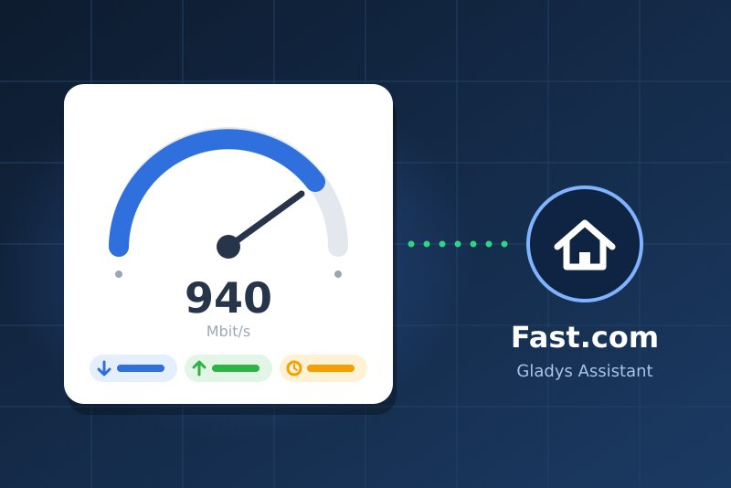
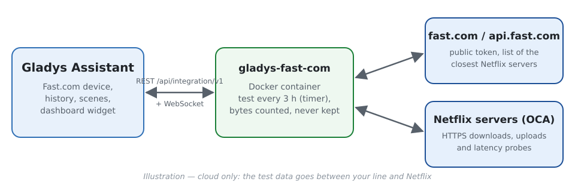
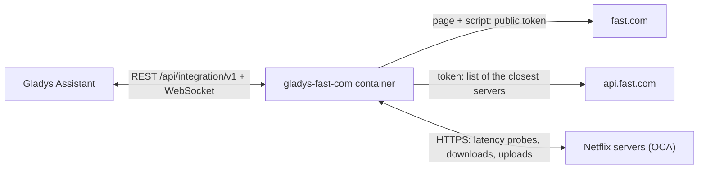
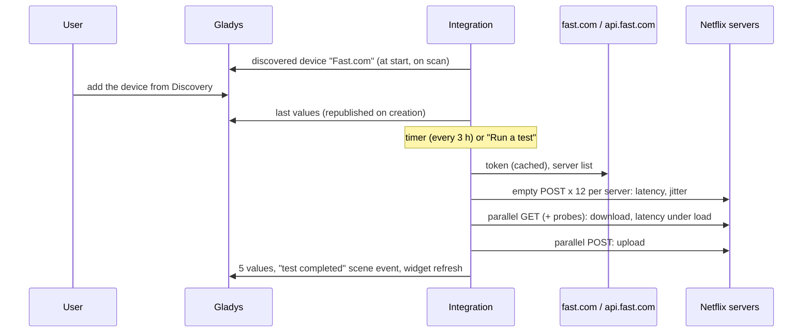
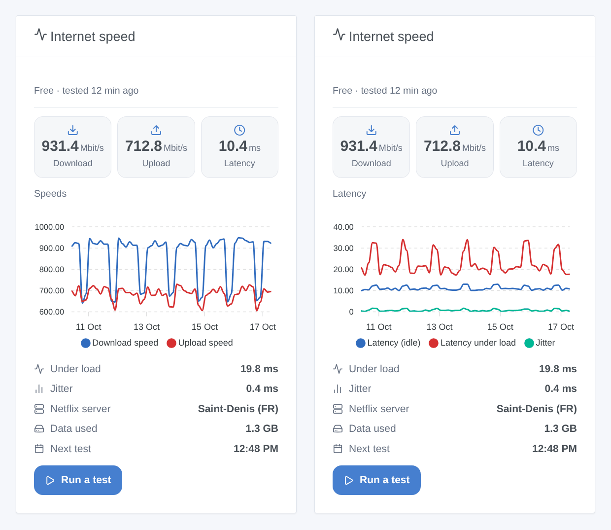

# Gladys Fast.com

**English** · [Français](README.fr.md) · [Deutsch](README.de.md) · [Español](README.es.md)

[](LICENSE)
[](https://github.com/William-De71/gladys-fast-com/releases)
[](https://github.com/William-De71/gladys-fast-com/actions/workflows/release.yml)
[](https://gladysassistant.com)



[Gladys Assistant](https://gladysassistant.com) external integration that measures your internet connection on a schedule with **Fast.com**, the speed test of Netflix. Download, upload, latency at rest and under load, and jitter become device values with history, a dashboard widget shows them with a "Run a test" button, and scenes react to finished or failed tests and to the return of the connection.

User documentation: [English](docs/en.md) · [Français](docs/fr.md) · [Deutsch](docs/de.md) · [Español](docs/es.md).

> Community integration, not affiliated with nor endorsed by Netflix. Fast.com offers no public API: the integration does what the fast.com web page does, and may need an update if Netflix changes it.

## Features

- A **Fast.com device** with five read-only values kept in history: download and upload (Mbit/s), latency at rest, jitter, latency under load (ms).
- **Automatic tests** by an internal timer: every 3 hours by default (30 minutes to once a day, or only on demand), each direction stopping as soon as the speed is stable (15 s at most by default).
- **3 scene triggers**, **1 scene action** and **1 dashboard widget** (below).
- **No account, no key, no proprietary binary**: pure Node.js, streamed measurement (nothing is buffered in the 256 MB of the container), one test at a time.
- **Outage detection**: while tests fail, a light check (a few kilobytes) every 5 minutes tells when the connection is back.
- Four languages everywhere: English, French, German, Spanish.

### Fast.com or Speedtest.net?

The store also offers [Speedtest.net](https://github.com/guim31/gladys-speedtest) (Ookla servers, also in pure JavaScript). The two answer slightly different questions: Speedtest.net measures towards a server of its catalog (chosen automatically or by you), Fast.com towards the **Netflix servers** your provider uses to stream video, often hosted inside its own network. This integration also measures the **latency under load** (how much a busy line delays everything else) and offers scene triggers and a scene action. Both can be installed side by side.

## How it works







The measurement follows the official web client (read from its code): `…/speedtest/range/0-0` POSTs for the latency (one HTTP round trip on a warm connection: within 1 ms of an ICMP ping in our tests), 25 MB ranges downloaded and uploaded on 2 to 8 connections depending on the speed, the result being the rate over the last seconds once the TCP ramp-up is over.

### Transport

`transports: ["cloud"]`: the test traffic goes between your line and the Netflix servers on the Internet; Netflix sees your public IP address, as with the fast.com page. Nothing else leaves your network, and the integration neither stores nor logs the IP address. The device shows the cloud badge, and "unreachable" while Internet is down.

## Devices and features

| Feature            | Category / type        | Unit   | Value                                                  |
| ------------------ | ---------------------- | ------ | ------------------------------------------------------ |
| Download speed     | `datarate` / `rate`    | Mbit/s | Rate over the last seconds of the download             |
| Upload speed       | `datarate` / `rate`    | Mbit/s | Same for the upload (when measured)                    |
| Latency (idle)     | `duration` / `decimal` | ms     | Median of 12 probes on the best server                 |
| Jitter             | `duration` / `decimal` | ms     | Mean difference between consecutive probes             |
| Latency under load | `duration` / `decimal` | ms     | Median of the probes during the download (bufferbloat) |

A threshold ("download below 100 Mbit/s") is a **condition on the device** in a scene, not a trigger.

## Scene triggers, actions and widgets



- Triggers: **test completed** (all the values as variables, filter: started by the schedule or by a person), **test failed** (reason `offline`, `service` or `measurement`, failures in a row), **connection restored** (outage duration in minutes).
- Action: **run a speed test** (with or without upload, 120 s timeout) whose values (download, upload, latency, jitter, latency under load, provider, server, data used, summary) feed the next actions. It never starts a Fast.com trigger in return.
- Widget: **Internet speed** — last values, history of the speeds or of the latency (from a day to three months, once the device is added), latency under load, jitter, server, data used, next test, and **Run a test**.
- Examples: when a test fails because Internet is offline, turn the router smart plug off and on again; when the connection is restored, send "Internet back after {{triggerEvent.data.outage_minutes}} min"; every evening at 9 pm, run a test and notify if the download is below 100 Mbit/s.

Not implemented: choosing the server (Fast.com picks it), a "speed below threshold" trigger (a condition on the device does it), choosing between IPv4 and IPv6 (the servers are the ones the API gives).

## Requirements

- Gladys **5.3.0** or later (older versions cannot install the integration: widget, scenes, catalog keywords of Gladys 5.3).
- An internet connection; a connection without data cap for frequent tests on a fast line.

## Installation

- **From the store**: Integrations → Fast.com → Install.
- **From the repository URL**: Integrations → Add an external integration → `https://github.com/William-De71/gladys-fast-com`.
- **Developer mode**: `npm install`, then run it next to a Gladys in developer mode with the variables below.

## Configuration

| Field                          | Default       | Purpose                                              |
| ------------------------------ | ------------- | ---------------------------------------------------- |
| Automatic test                 | Every 3 hours | 30 min, 1, 2, 3, 6, 12 h, once a day, or disabled    |
| Maximum duration per direction | 15 seconds    | 10, 15, 20 or 30 s; each direction stops once stable |
| Measure the upload too         | On            | Off: download and latency only (about half the data) |
| Language of the feature names  | Automatic     | Names given to the features when the device is added |

Configuration actions: **Run a test now** (waits for the result) and **Diagnostic** (a summary in the logs, without IP address).

**Data used**: at 1 Gbit/s, a test moved 1.2 to 1.4 GB in our measurements (both directions); on a slower line it is proportionally less. Every 3 hours, that is about 10 GB a day on a 1 Gbit/s line: choose a longer interval, or disable the upload, on a capped or 4G connection.

## Usage

Install, then add the **Fast.com** device from Discovery (it keeps the history) and the **Internet speed** widget to a dashboard. The first test runs about a minute after the start, then at the chosen interval; a restart does not run an extra test.

Good to know:

- **The line is shared**: a download, a video or a backup running on another device during a test lowers the result. Fast.com measures what is left, not the subscribed speed.
- **The container has 0.5 CPU**: the integration watches its own event loop. If the processor sets the pace instead of the line, the test is marked **limited by the processor** (widget, variable `cpu_limited`) and the latency under load is not published rather than wrong. On a recent x86 machine, our tests at 1 Gbit/s used about 0.2 CPU and were not limited; on a small board without AES instructions (Raspberry Pi 4), speeds above a few hundred Mbit/s may be under-estimated (not measured).
- **Compared with the fast.com page**, values differ by a few percent (download 913 to 933 Mbit/s against 960 shown by the page in a browser on the same line in our tests): the stop rule and the averaging are not identical.

## Development

```bash
npm install
npm test                     # node --test, never touches the network
npm run lint && npm run format:check
npm run measure              # a REAL test from this machine (hundreds of MB)
docker run --rm --cpus 0.5 --memory 256m -v "$PWD":/app:ro -w /app node:24-alpine node scripts/measure.mjs
npx github:GladysAssistant/integration-store . --skip-image-check
docs/illustrations/render.sh # widget illustrations
scripts/build-cover.sh       # cover.jpg
```

Environment variables (set by the Gladys supervisor): `GLADYS_HOST_API_URL`, `GLADYS_INTEGRATION_TOKEN`, `GLADYS_INTEGRATION_SELECTOR`, `TZ` (clock times shown). `DATA_DIR` (default `/data`) holds `state.json`: the last result and the failure in progress, without IP address.

## Release process


Every merge on `main` runs the CI, then computes the version from the [Conventional Commits](https://www.conventionalcommits.org/) since the last tag: `feat` → minor, `fix` / `perf` → patch, `!` or `BREAKING CHANGE` → major (a minor below 1.0.0); `docs`, `chore`, `ci`, `test`, `style`, `refactor`, `build` alone publish nothing. With no tag yet, 0.1.0 is released as is. The changelog section is generated, the tag pushed, the multi-architecture image built, then `main` receives the release commit (so the store never sees a version without its image), the GitHub Release is created and a last job checks the public image, the store validator and the topic.

- The pull request title becomes the squash commit, then the changelog line: write it in English, for the user (`pr-title.yml` checks it). Never edit `CHANGELOG.md` by hand.
- 1.0.0 is a decision: Actions → Release → Run workflow with `release-as: 1.0.0`. `dry-run` shows the version and the notes without publishing.
- **Protected branch**: the release pushes its commit to `main` with `GITHUB_TOKEN`. With a ruleset on `main`, add GitHub Actions to its bypass list (or push through a GitHub App), otherwise the publish job fails.
- After the first release, the `ghcr.io` package must be public (Package settings → Change visibility).

## Troubleshooting

See [docs/en.md](docs/en.md#troubleshooting) (lower speed than expected, processor limit, "Fast.com refused the test", no history). Report issues with the versions of Gladys and of the integration, your line, what fast.com shows in a browser on the same network, and the output of the **Diagnostic** button (Settings → Supervision).

## Contributing

Issues and pull requests are welcome. Run `npm run format:check && npm run lint && npm test` before opening a pull request, and keep every external id and stored key unchanged (see [CLAUDE.md](CLAUDE.md)).

## Security

See [SECURITY.md](SECURITY.md): report vulnerabilities privately. The integration has no secret to keep; it only talks to fast.com, api.fast.com and the Netflix servers listed by the API (HTTPS), and never stores nor logs your IP address.

## Screenshots to come

The images above are illustrations, not screenshots. Real screenshots will go in `docs/assets/screenshots/` (PNG, 1280 × 800): `configuration.png`, `discovery.png`, `device.png`, `dashboard.png`.

## License

[Apache License 2.0](LICENSE) — see also [NOTICE](NOTICE). Fast.com and Netflix are trademarks of Netflix, Inc.; this community integration is not affiliated with them. Thanks to the Gladys documentation and SDK.
