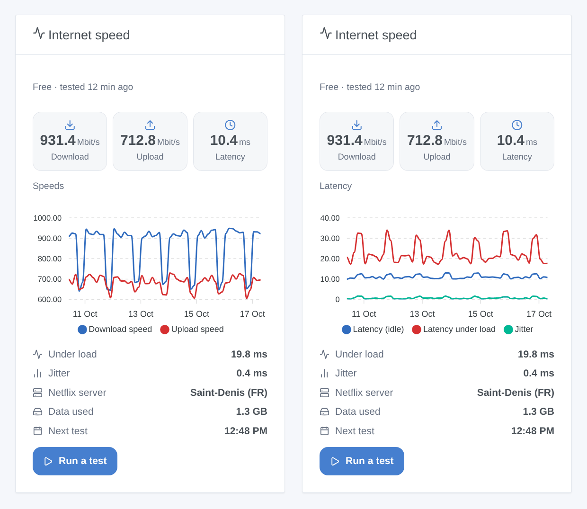

# Fast.com

## Overview

This integration measures your internet connection with **Fast.com**, the speed test of Netflix, on a schedule or on demand: download and upload speed, latency at rest, jitter and latency under load. The values are kept in the history of a **Fast.com** device, shown by a dashboard widget, and usable in scenes (test completed, test failed, connection restored, and an action to run a test).

No account and no key: like the fast.com page, the integration asks Fast.com for the Netflix servers closest to your line, then downloads and uploads data and times the answers. Fast.com offers no public API, so the integration follows what its web page does; Netflix may change it, and an update of the integration would then be needed.

Compared with the **Speedtest.net** integration of the store (Ookla servers), Fast.com measures towards the Netflix servers your provider uses to stream video, often inside its own network, and also gives the latency under load. Both can be installed side by side.

Transport: **cloud**. The test traffic goes between your line and the Netflix servers on the Internet, which see your public IP address (as with the fast.com page). The integration neither stores nor logs that address.

## Requirements

- Gladys 5.3.0 or later.
- An internet connection. A test moves a lot of data on a fast line: 1.2 to 1.4 GB at 1 Gbit/s in our measurements (both directions), proportionally less on a slower line. On a capped or 4G connection, choose a long interval or disable the upload.
- Gladys measures through **its own network link**: if it runs on Wi-Fi, or on a 100 Mbit/s network port, that is what limits the result.

## Configuration

Nothing is mandatory: the default values work.

| Field                          | Default       | Values                                                              |
| ------------------------------ | ------------- | ------------------------------------------------------------------- |
| Automatic test                 | Every 3 hours | Every 30 min, 1, 2, 3, 6 or 12 hours, once a day, or Disabled       |
| Maximum duration per direction | 15 seconds    | 10, 15, 20 or 30 s: each direction stops earlier once stable        |
| Measure the upload too         | On            | Off: download and latency only, about half the data                 |
| Language of the feature names  | Automatic     | The language of your dashboard, or English, French, German, Spanish |

Buttons of the configuration screen:

- **Run a test now**: runs a test (15 to 40 seconds) and shows its result.
- **Diagnostic**: writes the state of the integration (settings, last test, failure in progress, memory) to its logs, without IP address. Gladys passes no debug variable to the container: use this button before reporting a problem, then copy the lines from Settings → Supervision.

The first automatic test runs about a minute after the start; a restart of Gladys or of the integration does not run an extra test (the next one is planned from the last one).

## Usage

### Device

Open **Integrations → Fast.com → Discovery** and add the **Fast.com** device. Its five values are kept in history:

| Feature            | Unit   | What it is                                                               |
| ------------------ | ------ | ------------------------------------------------------------------------ |
| Download speed     | Mbit/s | Speed over the last seconds of the download, after the ramp-up           |
| Upload speed       | Mbit/s | Same for the upload (nothing published when the upload is not measured)  |
| Latency (idle)     | ms     | Median of 12 HTTP round trips on the closest server, the line being idle |
| Jitter             | ms     | Mean difference between two consecutive round trips                      |
| Latency under load | ms     | Same round trips while the download fills the line (bufferbloat)         |

A threshold is a **condition** on these values in a scene ("download speed below 100 Mbit/s"), not a trigger.

### Widget

The **Internet speed** widget shows the provider and the age of the last test, the download, upload and latency tiles, a chart, the latency under load, the jitter, the Netflix server, the data used, the time of the next test, and a **Run a test** button (the result appears at the end, without waiting in front of a spinner). Settings: the chart (download and upload, latency and jitter, or none) and its period (24 hours to 3 months). The chart reads the history of the device: add the device first.

### Scene triggers

- **Fast.com: test completed**: after each successful test, with every value as a variable (`{{triggerEvent.data.download_mbps}}`, `upload_mbps`, `latency_ms`, `jitter_ms`, `loaded_latency_ms`, `isp`, `server_city`, `data_used_mb`, `cpu_limited`…). Filter: started by the schedule or by a person.
- **Fast.com: test failed**: Internet unreachable (`offline`), Fast.com refusing the test (`service`) or nothing transferred (`measurement`), with the failures in a row. Filters: reason, started by.
- **Fast.com: connection restored**: Fast.com answers again after failed tests (checked every 5 minutes during the outage, a few kilobytes each time), with `outage_minutes`.

### Scene action

**Fast.com: run a speed test** (with or without upload) waits for the result (120 s at most) and gives its values to the next actions: download, upload, latency, jitter, latency under load, provider, server city, data used, processor limit and a summary (`↓ 923.6 Mbit/s · ↑ 717.6 Mbit/s · 10.5 ms`). It never starts a Fast.com trigger, and joins a test already running instead of starting a second one.

### Scene examples

- **Restart the router**: trigger "test failed" with the reason "Internet unreachable" → turn the router smart plug off, wait 30 seconds, turn it on.
- **Outage report**: trigger "connection restored" → send a message "Internet back after {{triggerEvent.data.outage_minutes}} min".
- **Evening check**: every day at 9 pm → run a speed test → if the download speed is below 100 Mbit/s, send "Slow line: {{…summary}}".

## Troubleshooting

- **The speed is lower than expected**: another device was downloading or watching a video during the test (the line is shared); Gladys is on Wi-Fi or on a 100 Mbit/s port; or the processor limited the test (see below). Compare with fast.com in a browser on a cabled computer at the same time.
- **"Limited by the processor"**: the integration has 0.5 CPU, and its event loop was late during the test: the speeds may be under-estimated, and the latency under load is left out rather than wrong. It happens on small boards on very fast lines (above a few hundred Mbit/s on a Raspberry Pi 4, which has no AES instructions). Reduce the load of the machine, or keep the result as a lower bound.
- **"Fast.com refused the test"**: Netflix changed its page or its token. The integration reads the token again on every refusal and checks every 5 minutes; if it lasts, update the integration and report it.
- **"Internet or Fast.com unreachable" while Internet works**: a DNS filter, an ad-blocker (Pi-hole, AdGuard) or a firewall may block `fast.com`, `api.fast.com` or `*.oca.nflxvideo.net`: allow them.
- **No chart in the widget**: add the Fast.com device from Discovery; the history starts with the next test.
- **The values differ from the fast.com page**: by a few percent, as the stop rule and the averaging are not identical; the trend over time is what matters.

## Limitations

- Unofficial: Fast.com has no public API; the integration reproduces its web client and depends on it.
- The server is chosen by Fast.com; IPv4 or IPv6 cannot be forced.
- One test at a time; a test lasts 15 to 40 seconds, 110 seconds at most.
- The upload is counted as the data leaves the integration for the network: exact once the transfer is steady (4.9 Mbit/s measured on a line limited to 5 Mbit/s), which the stop rule waits for.
- Measured in real conditions on a 1 Gbit/s link from an x86 computer, also limited to 0.5 CPU and 256 MB like in Gladys. Not measured on a Raspberry Pi nor above 1 Gbit/s.
